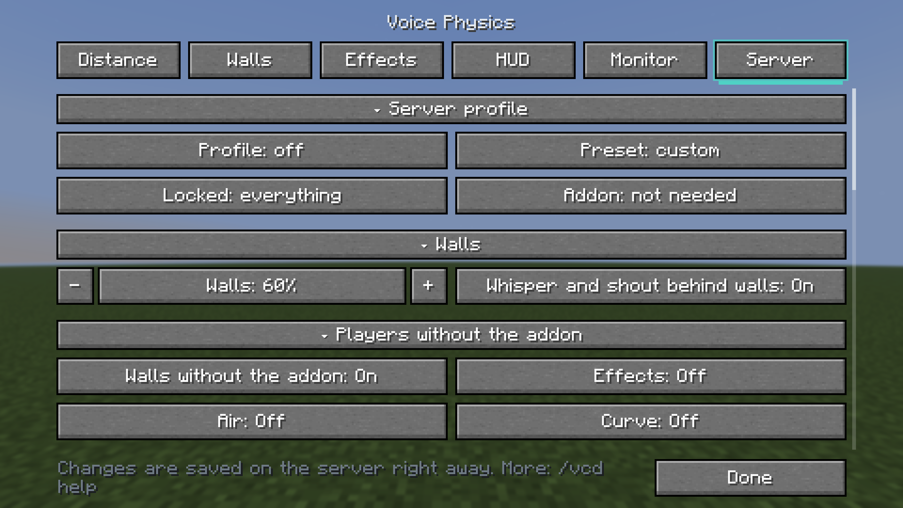

A server plugin for [Simple Voice Chat](https://hangar.papermc.io/henkelmax/SimpleVoiceChat) on **Paper, Purpur, Folia and Spigot** (Minecraft 1.16.5 – 26.3) that makes proximity voice chat realistic: **voices are muffled behind walls for every player, sound zones change how far a voice carries, and game rules decide who hears whom.**

Players **need nothing beyond Simple Voice Chat** — server-side wall occlusion, zones and game rules work for vanilla-with-SVC clients out of the box. Players who also install the [Voice Physics client mod](https://www.curseforge.com/projects/1712556) get custom fade curves, presets, doorway corners, cave echo, a HUD and a voice radar.

## What players hear

- **🧱 Walls** — voices behind walls are quieter and duller, and a whisper is lost behind a wall sooner than a shout. CPU load is capped (`server_walls_max_streams`), and on any error the original audio packet is sent untouched, so voice chat never goes silent.
- **🏛️ Sound zones** — a stage heard twice as far, a quiet library, a soundproof room, a cathedral with echo. Everyone sees the zone's name above the hotbar on entering.
- **🌊 Realism without the client mod** *(off by default)* — dull voices under water, far voices covered by rain and thunder, echo in caves, wind high up, a quieter voice behind the speaker's back, the Doppler effect and the server profile's distance curve.
- **🎙️ Player controls (`/voice`)** — lets any player talk quietly or shout, turn walls off for themselves, adjust individual players' volume and see who is talking nearby. Clickable in chat, with an inventory menu and undo.
- **💿 Music & radio addons** — works cleanly alongside custom music disc / jukebox addons (`music_physics` switch) and leaves walkie-talkies and radio speakers untouched.

## Tools for admins

- **Zones** — draw a box in game with `/vcd zone`, or bind a whole world, a **WorldGuard** region (`vcd-zone` flag or `zone.region.*`), a **Towny** town or a **Lands** land.
- **Game rules** — sneaking is quieter, the dead are silent until respawn, spectators talk only to each other, and a goat horn (or any item) works as a directional megaphone that sounds like one.
- **Fair play** — offer or lock the server's audio settings for players with the client mod, and turn off their monitor and radar so nobody sees through walls in PvP or hide-and-seek.
- **Require the client mod** — send a clickable download link, remind on every join, or kick.
- **Voice moderation & chat-mute sync** — `/vcd mute <player> [time] [reason]`, `/vcd unmute`, `/vcd mutes`, plus optional automatic voice-mute sync with **EssentialsX**, **LiteBans**, **LibertyBans** and **AdvancedBan**.
- **PlaceholderAPI** — `%vcd_mode%`, `%vcd_talking%`, `%vcd_zone%`, `%vcd_muted%`, `%vcd_range%` and more for scoreboards, tab lists and chat formats.
- **Extras** *(off by default, `/vcd extras`)* — frequency radio (`/voice radio`), placed loudspeakers (`/vcd speaker add`), an eavesdrop spyglass, sculk / warden reactions to shouts, server doorway sound, and **LuckPerms** contexts (`vcd:mode`, `vcd:walls`, `vcd:zone`) + chat-mute sync.
- **Clickable `/vcd` & in-game Server tab** — every `/vcd` command has clickable buttons, undo (`/vcd undo`), a change log (`/vcd log`), `/vcd debug <player>` to inspect who hears whom and why, and messages in 7 languages. Admins who run the client mod can toggle everything from its **Server** tab.

## Install

1. Put `voice-physics-bukkit-*.jar` into `plugins/` alongside [Simple Voice Chat](https://hangar.papermc.io/henkelmax/SimpleVoiceChat).
2. Restart the server. Settings live in `plugins/VoicePhysics/vc-audio-distance-server.properties` and can all be changed live with `/vcd`.

- **Platforms:** Paper, Purpur, **Folia** (`folia-supported: true`), Spigot, Bukkit — one jar for **Minecraft 1.16.5 – 26.3** (Java 8+ on 1.16.5, Java 17+ on 1.18+).
- **Permissions:** `vcd.status`, `vcd.settings`, `vcd.zone`, `vcd.debug`, `vcd.mute`, `vcd.speaker`, `vcd.admin` (operators have all by default); `vcd.voice` (default `true`) for `/voice`.
- **Statistics:** sends anonymous server counts to [bStats](https://bstats.org) (no player names, IPs, chat or voice). Set `metrics=false` in `plugins/VoicePhysics/vc-audio-distance-server.properties` to disable.

**[All settings, commands and permissions →](https://github.com/Shamanalle/voice-physics#for-servers)** · [Changelog](https://github.com/Shamanalle/voice-physics/blob/main/CHANGELOG.md) · [Questions and problems](https://github.com/Shamanalle/voice-physics#questions-and-problems) · [Report a bug](https://github.com/Shamanalle/voice-physics/issues)

---

<b>🇷🇺 Русский</b>

Серверный плагин для [Simple Voice Chat](https://hangar.papermc.io/henkelmax/SimpleVoiceChat) на **Paper, Purpur, Folia и Spigot** (Minecraft 1.16.5 – 26.3): **голоса глохнут за стенами у каждого игрока без клиентских модов, звуковые зоны меняют дальность и акустику, а правила игры решают, кто кого слышит.**

Игрокам **достаточно одного Simple Voice Chat**. А тем, кто поставит и клиентский мод Voice Physics, добавятся кривые затухания, пресеты, обход углов через проёмы, пещерное эхо, HUD и голосовой радар.

### Что получают игроки и админы

- **🧱 Стены на сервере** — голоса за стенами тише и глуше, шёпот теряется раньше крика. Нагрузка ограничена (`server_walls_max_streams`), а при любой ошибке отправляется исходный звук.
- **🏛️ Звуковые зоны** — сцена, тихая библиотека, звукоизолированная комната, собор с эхом; привязка к кубоидам (`/vcd zone`), мирам, регионам **WorldGuard**, городам **Towny** и землям **Lands**.
- **🎙️ `/voice` для игроков и PlaceholderAPI** — выбор режима речи (тихо / обычно / громко), личная громкость игроков, меню в инвентаре и плейсхолдеры `%vcd_...%` для таба и скорбордов.
- **🔇 Голосовые муты и синхронизация с чат-мутами** — `/vcd mute`, `/vcd unmute`, `/vcd mutes`, а при включённых интеграциях — автоматическое заглушение голоса при чат-муте в **EssentialsX**, **LiteBans**, **LibertyBans** и **AdvancedBan**.
- **⚙️ Правила игры и дополнения** — тише на корточках, молчание мёртвых, отдельный голос наблюдателей, козий рог как направленный мегафон, рация (`/voice radio`), громкоговорители, подслушивание через подзорную трубу, реакция скалка и вардена на крик, контексты **LuckPerms**.

**[Все настройки, команды и права →](https://github.com/Shamanalle/voice-physics/blob/main/README.ru.md#для-серверов)** · [Список изменений](https://github.com/Shamanalle/voice-physics/blob/main/CHANGELOG.md) · [Сообщить об ошибке](https://github.com/Shamanalle/voice-physics/issues)

